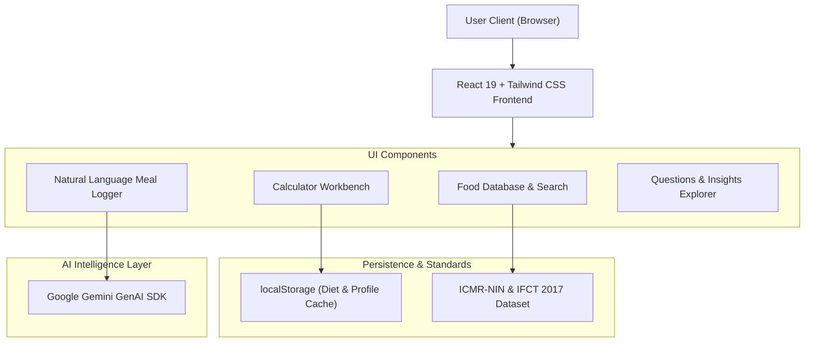

# 🇮🇳 NutriBharat — Research & Product Intelligence Portal

[](https://react.dev/)
[](https://www.typescriptlang.org/)
[](https://vitejs.dev/)
[](https://tailwindcss.com/)
[](https://ai.google.dev/)
[](https://www.nin.res.in/)

> A full-stack, India-first nutrition intelligence portal and health engine. Built to bridge the critical gap in existing calorie-tracking platforms by incorporating authentic Indian dietary habits, standard Indian household measurements (*katori*, *roti*, *ladle*, *spoons*), regional recipes, and Gemini-powered natural language meal logging.

---

## 📸 Application Overview & Visual Previews

### 1. Indian Food & Regional Nutrition Database
```
+------------------------------------------------------------------------------------+
|  [🌱 Veg Mode / 🍗 Non-Veg Mode]   Search: "paneer bhurji", "rajma chawal", "idli"|
+------------------------------------------------------------------------------------+
|  Item                   | Serving Size       | Calories | Protein | Carbs | Fat    |
|-------------------------+--------------------+----------+---------+-------+--------|
|  Paneer Bhurji          | 1 standard katori  | 260 kcal | 14.2g   | 6.5g  | 19.8g  |
|  Dal Tadka (Toor)       | 1 medium katori    | 150 kcal | 8.5g    | 21.0g | 3.2g   |
|  Whole Wheat Roti       | 1 medium (40g)     | 110 kcal | 3.5g    | 22.0g | 0.8g   |
|  Curd / Dahi            | 1 cup (150g)       | 98 kcal  | 4.6g    | 6.8g  | 5.2g   |
+------------------------------------------------------------------------------------+
|  * Calibrated according to ICMR-NIN & Indian Food Composition Tables (IFCT 2017)   |
+------------------------------------------------------------------------------------+
```

### 2. Natural Language AI Meal Logger (Hinglish / English)
```
+------------------------------------------------------------------------------------+
|  Input: "Subah 2 roti khayi thi dal tadka ke sath aur ek cup chai with 1 spoon sugar"|
|                                                                                    |
|  [⚡ Parse with Gemini AI Engine]                                                  |
+------------------------------------------------------------------------------------+
|  [✓] Detected 4 items:                                                             |
|      - 2x Whole Wheat Roti     --> 220 kcal | 7.0g Protein | 44g Carbs | 1.6g Fat  |
|      - 1x Dal Tadka (1 katori) --> 150 kcal | 8.5g Protein | 21g Carbs | 3.2g Fat  |
|      - 1x Chai with milk       -->  65 kcal | 1.8g Protein |  8g Carbs | 2.5g Fat  |
|      - 1x Table Sugar (5g)     -->  20 kcal | 0.0g Protein |  5g Carbs | 0.0g Fat  |
|  Total Logged: 455 kcal | Protein: 17.3g | Carbs: 78g | Fat: 7.3g                 |
+------------------------------------------------------------------------------------+
```

### 3. Interactive Calculator Workbench
```
+------------------------------------------------------------------------------------+
|  [BMR & TDEE]    |   [Macro Splitter]   |   [Hydration]   |   [Deficit Planner]    |
+------------------------------------------------------------------------------------+
|  Inputs: Age, Gender, Weight (kg), Height (cm), Activity Level, Goal               |
|  Target Calories: 1,850 kcal/day (500 kcal Deficit for Healthy Fat Loss)           |
|  Suggested Split:  Protein 115g (25%)  |  Carbs 230g (50%)  |  Fats 51g (25%)      |
+------------------------------------------------------------------------------------+
```

---

## ✨ Key Features

1. **ICMR-NIN Calibrated Food Database**:
   - Covers regional Indian cuisines (North, South, East, West).
   - Household measurement units: *katori*, *roti*, *piece*, *teaspoon*, *tablespoon*, and *grams*.
   - Filter by diet preference (**Vegetarian**, **Non-Vegetarian**, **Vegan**, **Jain**).

2. **AI Natural Language Meal Logger**:
   - Powered by **Google Gemini API**.
   - Accepts multi-item natural conversational inputs in **English**, **Hindi**, or colloquial **Hinglish**.
   - Automatically decomposes complex meals into ingredients, calculates nutritional breakdown, and suggests corrections.

3. **Clinical & Fitness Calculators**:
   - **Mifflin-St Jeor & Harris-Benedict BMR / TDEE** calculators calibrated for South Asian body composition profiles.
   - Macro nutrient distribution tailored for vegetarian and non-vegetarian Indian food options.
   - Water and electrolyte hydration planner based on Indian climate zones.

4. **NutriBharat Market & User Research Suite**:
   - In-depth market demand analysis for Indian nutrition.
   - Competitor benchmarking matrix (vs. MyFitnessPal, HealthifyMe, Fittr, Cronometer).
   - Real search queries, user questions explorer, and product gap documentation.

---

## 🏗️ System Architecture



---

## 🚀 Getting Started

Follow these step-by-step instructions to run the project locally on your machine.

### Prerequisites

Ensure you have the following installed:
- **Node.js** (v18.0.0 or higher recommended) -> [Download Node.js](https://nodejs.org/)
- **npm** (comes bundled with Node.js) or **yarn** / **pnpm**
- **Git** -> [Download Git](https://git-scm.com/)

---

### Step-by-Step Installation Guide

#### 1. Clone the Repository
```bash
git clone https://github.com/Gauravmishra316/nutribharat-research---product-intelligence-portal.git
cd nutribharat-research---product-intelligence-portal
```

#### 2. Install Dependencies
```bash
npm install
```

#### 3. Set Up Environment Variables
Create a `.env.local` file in the root directory:
```bash
cp .env.example .env.local
```
Open `.env.local` and add your **Google Gemini API Key**:
```env
GEMINI_API_KEY=your_actual_gemini_api_key_here
```
> [!TIP]
> You can generate a free API key at [Google AI Studio](https://aistudio.google.com/app/apikey).

#### 4. Run Development Server
```bash
npm run dev
```
Once started, open your browser and navigate to:
```
http://localhost:3000
```

#### 5. Build for Production
```bash
npm run build
```
To preview the production build locally:
```bash
npm run preview
```

---

## 📂 Project Directory Structure

```
nutribharat-research-&-product-intelligence-portal/
├── research/                               # Strategic market & product research
│   ├── 01-search-demand.md                 # Search volume & Indian user intent
│   ├── 02-user-questions.md                # Real consumer nutrition FAQs
│   ├── 03-indian-food-search.md            # Nutritional taxonomy of regional food
│   ├── 04-competitors.md                   # Market competitor landscape
│   ├── 05-gaps.md                          # Identified industry gaps & opportunities
│   ├── 06-product-design.md                # UX/UI principles & IA
│   ├── 07-ia-seo.md                        # Information architecture & SEO strategy
│   ├── 08-calculators.md                   # Mathematical models & formulas
│   └── 09-mvp-roadmap-journeys-safety.md   # Product roadmap & clinical disclaimers
├── src/
│   ├── components/
│   │   ├── CalculatorWorkbench.tsx         # BMR, TDEE, Deficit & Macro Calculators
│   │   ├── CompetitorMatrix.tsx            # Interactive competitor analysis table
│   │   ├── FoodDatabase.tsx                # Indian food database & portion converter
│   │   ├── NaturalLanguageLogger.tsx       # AI meal parser (Gemini API)
│   │   ├── Navbar.tsx                      # Top bar with veg/non-veg diet toggle
│   │   ├── QuestionExplorer.tsx            # Consumer question search & insights
│   │   └── ReportViewer.tsx                # Embedded report viewer
│   ├── data/
│   │   └── researchData.ts                 # Master dataset, food list, calculations
│   ├── App.tsx                             # Main dashboard & tab routing
│   ├── index.css                           # Tailwind CSS stylesheet
│   └── main.tsx                            # React entry point
├── FINAL-REPORT.md                         # Executive summary & product brief
├── package.json                            # Scripts & dependencies
├── tsconfig.json                           # TypeScript configuration
└── vite.config.ts                          # Vite build configuration
```

---

## 🛠️ Technology Stack

| Layer | Technologies Used |
| :--- | :--- |
| **Frontend Framework** | [React 19](https://react.dev/), [TypeScript](https://www.typescriptlang.org/) |
| **Build Tooling** | [Vite 8.3](https://vitejs.dev/) |
| **Styling** | [Tailwind CSS v4](https://tailwindcss.com/) |
| **Iconography & Motion** | [Lucide React](https://lucide.dev/), [Framer Motion](https://motion.dev/) |
| **AI / Natural Language** | [Google Gemini GenAI SDK (`@google/genai`)](https://www.npmjs.com/package/@google/genai) |
| **Scientific Data Reference**| ICMR-National Institute of Nutrition (NIN) & IFCT 2017 |

---

## 📜 Scientific Nutrition Disclaimer

> *NutriBharat is an informational and research platform intended for dietary awareness and nutrition planning. Nutritional values are derived from published ICMR-NIN and IFCT tables. Individuals with chronic medical conditions (such as diabetes, renal disorders, or cardiovascular conditions) should consult an accredited physician or registered dietitian before undertaking any restrictive diet plan.*

---

## 🤝 Contributing

Contributions, issues, and feature requests are welcome!
1. Fork the Project.
2. Create your Feature Branch (`git checkout -b feature/AmazingFeature`).
3. Commit your Changes (`git commit -m 'Add some AmazingFeature'`).
4. Push to the Branch (`git push origin feature/AmazingFeature`).
5. Open a Pull Request.

---

## 👤 Author

- **Gaurav Mishra**
- GitHub: [@Gauravmishra316](https://github.com/Gauravmishra316)
- Repository: [nutribharat-research---product-intelligence-portal](https://github.com/Gauravmishra316/nutribharat-research---product-intelligence-portal)
